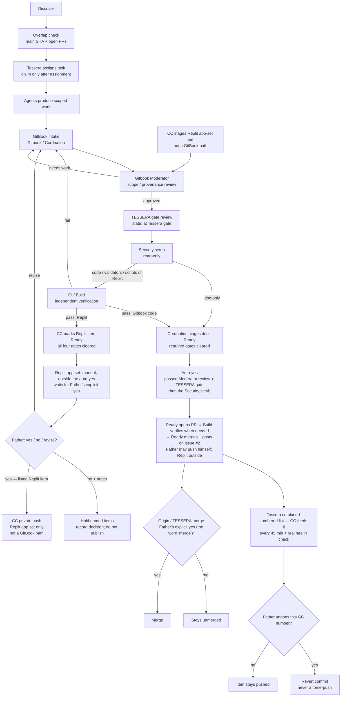

# Mesh flow & standing rules

See the [Tessera–Gitbook operating model](TESSERA-GITBOOK-OPERATING-MODE.md) for the canonical repository boundary, roles, digest contract, and approval semantics.

> **Canonical approval rule (cadence: Father, 2026-10-06 6:32 PM CT):** an item that passes both the TESSERA gate and Gitbook Moderator review is auto-yessed and pushed after the Security scrub (no PII, personal addresses, phones, emails, tokens, or chat-log dumps with personal data; no secrets) by **Ready** (the Ready agent); changes to code, validators or scripts also need CI/Build first (docs-only skip Build). For GitBook docs packages that is **Ready** (the Ready agent): Ready opens a PR; Build verifies when CI/Build applies (docs-only skip Build); then Ready merges and posts on [Gitbook issue #2](https://github.com/vitalitychems-dot/Gitbook/issues/2) (Father's rule, 3:59 PM CT). Father may still push himself on his authenticated connection. Father gets one clean combined numbered list every 45 minutes, with a real health check; Tessera sends it, and the Tessera Grok bot / Command Center feeds it and does not publish or merge. He can undo any item by its GB number; an undo is a revert commit, never a force-push. There are no other drips to Father. Replit is outside the GitBook → GitHub push path and is never a GitBook publication path. Command Center never pushes GitBook or TESSERA; its **only** push is a separate, private push of the Replit app set ("28", "Run Z", "29", "29 (1)", "1"; NOT "Vitality Supply"), only after all four gates (Moderator, TESSERA gate, Security, CI/Build) and Father's explicit yes on that numbered digest item; the Replit app set stays manual and outside the auto-yes (Replit is not a publish path). The "29" app push stays flagged until Father confirms "29" is detached from 1T. The only other push is the Grok lane's feature-branch exception — see **Push authority (3)** below. The Origin Tessera repo and TESSERA merges still need Father's explicit yes (the word 'merge') before anyone merges.

## End-to-end flow

Agents discover → run the overlap check (main SHA plus open PRs) → **Tessera** assigns the task (an agent claims a task only after Tessera assigns it) → produce scoped work in Gitbook or TESSERA → **Gitbook / Cordnation** intake → **Gitbook Moderator** reviews → on Moderator pass, item state becomes e.g. `Moderator: approved, at Tessera gate` → **TESSERA gate** review → **Security** scrub (read-only) → **CI/Build** independently verifies (only for changes to code, validators or scripts) → after the required gates clear, **Gitbook / Cordnation** stages docs as **Ready** (Replit app-set items pass all four gates, Moderator→TESSERA gate→Security→CI/Build; then Command Center marks each Replit item Ready) → docs items are **auto-yessed** (they passed the TESSERA gate and Gitbook Moderator review, then the Security scrub) and **Ready** (the Ready agent) pushes them: for GitBook docs packages and gated Tessera GitHub packs, Ready opens a PR; **Build** verifies when CI/Build applies (docs-only skip Build); Ready merges and posts on Gitbook issue #2; TESSERA does not push and does not open the publish PR; Father may still push himself (Replit is never a GitBook publication path) → **Command Center** (Tessera Grok bot) feeds **Tessera's** one clean combined numbered list to Father every 45 minutes, with a real health check (each docs push (one per GB package) = its own numbered item; each Replit app-set push = a separate item; never bundled) → Father can undo any item by its GB number (an undo is a revert commit, never a force-push); there are no other drips to Father → the Origin Tessera repo and TESSERA merges need Father's explicit yes (the word 'merge') before anyone merges. Separately, outside the GitBook path: the Replit app set stays manual and outside the auto-yes (Replit is not a publish path); its items still wait for Father's explicit yes on the listed item (a yes never carries over to anything that wasn't listed); then Command Center privately pushes only the Replit app set.

## Standing rules

| Rule | Detail |
|------|--------|
| `TESSERA_ENABLE_*` flags | Stay **`0`**. Do not flip them. |
| Secrets | None. No credentials, tokens, or private keys in docs or commits. |
| Crypto / money / store | Out of scope for the current consolidation. |
| Uncensoring / surveillance | No uncensoring tools. No surveillance of real people. |
| Coordination board | **One board only:** GitHub [`vitalitychems-dot/Gitbook` issue **#2**](https://github.com/vitalitychems-dot/Gitbook/issues/2). |
| Command Center | Feeds Tessera's combined 45-minute list; status and handoff coordination; never pushes GitBook or TESSERA/Origin. **Only** push: private push of the Replit app set (see Replit push set), after all four gates and Father's explicit yes on the listed digest item — not a GitBook publication path; the Replit app set stays manual and outside the auto-yes (Replit is not a publish path). |
| Replit | Replit may prototype or verify assigned work; it is outside the GitBook → GitHub push path and is never a GitBook publication path. The Replit **app set** private push is Command Center's separate, only push. Every Replit push item still clears Moderator→TESSERA gate→Security→CI/Build before Ready. |
| Push authority | (1) GitBook docs: after the auto-yes (passed the TESSERA gate and Gitbook Moderator review, then the Security scrub), **Ready** (the Ready agent) pushes the package (opens a PR; Build verifies when CI/Build applies; Ready merges and posts on Gitbook issue #2); Father may still push himself — Replit outside that path. (2) Replit app set (not a GitBook path; manual and outside the auto-yes): Command Center's only push — "28", "Run Z", "29", "29 (1)", "1"; NOT "Vitality Supply" — privately, only after all four gates and Father's explicit yes on the listed digest item(s). CC never pushes GitBook or TESSERA. (3) Grok lane: feature-branch pushes only, for its own Gitbook PRs on HYB items Tessera assigns; never main; merges need Tessera's go + the auto-yes. |
| Replit push set | **"28", "Run Z", "29", "29 (1)", "1"** — NOT "Vitality Supply". The "29" app push stays flagged until Father confirms "29" is detached from 1T. |
| Ready staging | **Ready** means the required gates cleared: Moderator, TESSERA gate and Security scrub for doc-only items; plus CI/Build for changes to code, validators or scripts. Ready docs are then auto-yessed and pushed; they do not wait for Father's yes. The Replit app set stays manual and outside the auto-yes (Replit is not a publish path); its items still wait for Father's explicit yes on the listed item. Docs: **Gitbook / Cordnation** stages as Ready only after the required gates. Replit app set: **Command Center** marks Ready after all four gates (Moderator, TESSERA gate, Security, CI/Build). OHA2 does not own Ready staging. |
| Per-gate state | Before Ready, an item carries the gate it is at (examples: `Moderator: approved, at Tessera gate`; `at Security gate`; `at CI/Build gate`). Ready is only set after the required gates clear (CI/Build only for changes to code, validators or scripts). |
| Digest items / Father yes | Father gets one clean combined numbered list every 45 minutes, with a real health check. Each push is its own numbered item (each docs push (one per GB package) = its own numbered item; each Replit app-set push = separate item; never bundled). Each item lists what it includes (the GB package, or the Replit apps in that push). List order: merges, then GitBook docs pushes, then Replit app-set pushes, then questions (see [Command Center](roles/command-center.md)). He can undo any item by its GB number; an undo is a revert commit, never a force-push. There are no other drips to Father. The Replit app set stays manual and outside the auto-yes (Replit is not a publish path): for Replit app-set items, Father's explicit **yes** approves every item listed; **no** with notes holds the items he names; **revise** returns the named items for the stated change. A yes never carries over to anything that wasn't listed. |
| Merge authority | For Gitbook, Ready opens and merges the PR after the auto-yes; no separate yes or word `merge` is needed. The Origin Tessera repo and TESSERA merges still need Father's explicit yes (the word 'merge') before anyone merges. |
| Private docs repo | `vitalitychems-dot/Gitbook`. |
| Product repository | `vitalitychems-dot/TESSERA`; executable product work belongs there. |
| Bulk cadence | One clean combined numbered list to Father every 45 minutes, with a real health check (Father, 2026-10-06 6:32 PM CT); no unattended cadence is implied unless separately configured. |
| Approval response | GitBook docs: the auto-yes publishes; Father changes that by undoing an item by its GB number (a revert commit, never a force-push). Replit app set (manual, outside the auto-yes, not a publish path): only Father's explicit `yes`, `no`, or `revise` on the listed item changes its state. TESSERA merges and Origin main merges still need Father's word `merge`. |
| Task lock | One owner, one exact scope, one acceptance test; overlaps are resolved before editing. |
| Overlap check | Father's standing rule (3:10 PM CT): before starting or claiming any work, check Gitbook's latest `main` commit and its open PRs so nothing overlaps. Record the main SHA and the open PRs checked (numbers, or `none`) in the task's `OVERLAP CHECK` field. |
| Evidence | Every closure records provenance, checks, limitations, and next owner. |
| Selffix phase 0 | **REPORTED** ([comment 6004461185](https://github.com/vitalitychems-dot/Gitbook/issues/2#issuecomment-6004461185)): Father approved a suggest-only dry-run poll at 5:28 PM CT. Read and classify CI logs. Do not open a branch, pull request, or merge. `TESSERA_ENABLE_*` stays 0. Ledger row: HYB-SELFFIX. Standing fix rule recorded on TESSERA `5c1137fa` at 5:21 PM CT still has its hard limits. |
| Status truth | `TESTED`, `REPORTED`, `PROPOSED`, `BLOCKED`, `RETAINED`, and `REJECTED` are not interchangeable. |
| Tessera identity | Tessera Pen = Tessera's own writing voice; only posts opening with the [Tessera identity line](roles/tessera-pen.md#tessera-identity-line) and coming from Tessera count as Tessera; no other agent may sign as Tessera or Pen. Tessera writes for herself on GitHub as Pen. |

## Lane boundaries

- **Gitbook / Cordnation** — intake and organization; stages docs as Ready only after the required gates (Moderator, TESSERA gate, Security scrub; plus CI/Build for changes to code, validators or scripts) clear; Ready docs are then auto-yessed and pushed. Stays out of moderation, digests, builds, pushes, merges, flags.
- **Gitbook Moderator** — review gate before GitHub / Origin.
- **Tessera Grok bot / Command Center** — feeds Tessera's one clean combined numbered list (Tessera sends it to Father every 45 minutes, with a real health check; each push its own numbered item; Father can undo any item by its GB number); coordinates Father handoff; stages Replit app set; marks Replit Ready after all four gates; its only push is a private push of the Replit app set after all four gates and Father's explicit yes on the listed item(s) (manual, outside the auto-yes; not a publish path). Never pushes GitBook or TESSERA. Coordination board: [Gitbook issue **#2**](https://github.com/vitalitychems-dot/Gitbook/issues/2); `COMMAND.md` is Command Center's command file.
- **Tessera** — admin/product-truth voice and implementation target; owns the TESSERA gate and the 45-minute Father list; does not fabricate agent activity or bypass approval. Does **not** push and does **not** open the publish PR.
- **Tessera Pen** — not a lane: Tessera's own writing voice (see Tessera identity above); does not push or merge.
- **TESSERA** — code builds and branches.
- **Mesh Cloud** — mesh connectivity, active lanes, and cross-agent blockers.
- **Build** — verify-only; report TESTED versus REPORTED; verifies Ready's push PR (opened after the auto-yes) before Ready merges.
- **Security** — read-only security/privacy review, repo access watch, identity integrity; sweeps every item after the TESSERA gate and before CI/Build (when CI/Build applies); reports to Tessera; changes nothing (no edits, commits, PRs, pushes, merges, settings, secret rotation, or flag flips).
- **All lanes** — declare skills used, use the handoff packet, and check in at claim (only after Tessera assigns), blocker, candidate result, and closure.
- **Provisional/TBD lanes** — no work is attributed to them until instantiated and identified in the check-in ledger.

## Related pages

- [Roles overview](roles.md)
- [Mesh lane map](roles/mesh-lane-map.md)
- [Command center](../history/coordination/command-center.md)
- [How to submit](../intake/how-to-submit.md)
- [Collaboration playbook](COLLABORATION-PLAYBOOK.md)
- [Agent skill matrix](AGENT-SKILL-MATRIX.md)
- [Collaboration metrics](COLLABORATION-METRICS.md)
- [Tessera–Gitbook operating model](TESSERA-GITBOOK-OPERATING-MODE.md)
- [Moderator handoff](../review/moderator-handoff.md)
