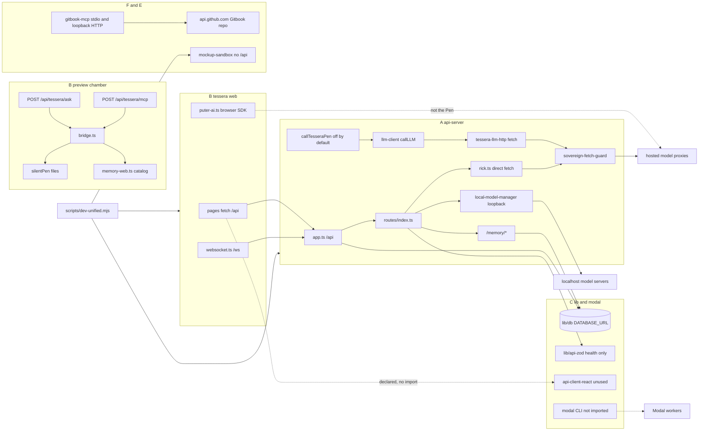

# Architecture bridge map

Base: `49474360264aefbe993729db8fa0cd470e7892dd` (merge of pull request #62).
This file is a map of how the live pieces call each other. It is the first step toward a Tessera that runs sovereign, local, with no hosted API, and free of charge. Nothing in this pull request changes code, flags, or data.

**Verified** means the line was read, or an importer search was run, on this commit.
**Unverified** means a guess that was not confirmed by reading that code.

Held paths are named here and were not opened: `data/`, `preview/src/lib/tessera/constitution-seal.ts`, `preview/src/lib/tessera/ingest.ts`, `preview/src/lib/tessera/self-ingest.ts`, `preview/src/lib/tessera/self-ingest.test.ts`. A filename walk found no live `natal-vault` file and no `data/school/pen-slot.json`. `artifacts/api-server/.local-data` is absent. Archive zips and the local trees named `1T` and `T44` are counted by directory only.

Env var **names** only. No values. `TESSERA_PEN_ENABLED` stays `0` in `.env.example`. This pull request does not set `DATABASE_URL`.

The Pen adapter in code is Tessera Pen (`callTesseraPen`). It is opt-in and off unless `TESSERA_PEN_ENABLED` is `1` or `true`.

## Workspace wiring (verified)

`pnpm-workspace.yaml` includes `artifacts/*`, `projects/*`, `lib/*`, `lib/integrations/*`, and `scripts`. There is no `projects/` directory and no `lib/integrations/` directory on this commit. `preview/` is not a workspace package and has no `package.json`.

Root scripts (`package.json`):

| Script | Mechanism | File |
|---|---|---|
| `dev` | subprocess `node scripts/dev-unified.mjs` | `package.json:7` |
| `build` | subprocess `node scripts/build-unified.mjs` | `package.json:8` |
| `typecheck:libs` | `tsc --build` using `tsconfig.json` project references | `package.json:9`, `tsconfig.json:4-15` |

`tsconfig.json` references only `lib/db`, `lib/api-client-react`, and `lib/api-zod`.

`scripts/dev-unified.mjs` spawns `pnpm --filter <selector> run dev` (`scripts/dev-unified.mjs:111-114`):

| Child | Workspace name | Default port env | Notes |
|---|---|---|---|
| Tessera web | `@workspace/tessera` | `TESSERA_WEB_PORT` (fallback 3000) | Sets `VITE_API_URL` to `http://localhost:` plus `TESSERA_API_PORT` (fallback 5000) at lines 24-34 |
| UI preview sandbox | `@workspace/mockup-sandbox` | `MOCKUP_SANDBOX_PORT` (fallback 5173) | This is `artifacts/mockup-sandbox`, not `preview/` |
| Tessera API | `@workspace/api-server` | `TESSERA_API_PORT` | Started only when `DATABASE_URL` is a loopback Postgres URL (`scripts/dev-unified.mjs:47-59`) |

`artifacts/gitbook-mcp` and `modal/` are not in that spawn list. `preview/` is not started by the unified runner.

Package dependency edges (verified from each `package.json`):

- `@workspace/api-server` depends on `@workspace/api-zod` and `@workspace/db` (`artifacts/api-server/package.json:18-19`). HTTP stack is `express` and `ws`. No `axios`. No hosted-model SDK in `dependencies`.
- `@workspace/tessera` depends on `@workspace/api-client-react` (`artifacts/tessera/package.json:51`). A search of `artifacts/tessera/src` found **no** import of that package. The UI calls `fetch("/api/...")` itself.
- `@workspace/db` uses `pg` and reads `DATABASE_URL` at process start (`lib/db/src/index.ts:7-13`).
- `@workspace/api-spec` generates the React client and the Zod package via Orval (`lib/api-spec/orval.config.ts:16-39`).
- `@workspace/api-zod` is imported by the API health route only (`artifacts/api-server/src/routes/health.ts:2`) plus its test.

## Slice A — `artifacts/api-server`

**Owner:** Build + Security review.
**Verified size:** 384 files (372 `.ts`). Planning notes said about 346. This commit is larger. Layout: `src/routes` 86 files, `src/lib` 204 files in that directory listing, `src/__tests__` 38 files.

### Process entry

1. `src/index.ts:1-2` installs `installSovereignFetchGuard()` before other imports.
2. `src/index.ts:7` imports the Express app from `src/app.ts`.
3. `src/index.ts:27-28` imports `@workspace/db`.
4. `src/index.ts:31` requires `PORT`.
5. `src/index.ts:45` wraps the app in `http.createServer`.
6. `src/index.ts:77` mounts `WebSocketServer` on path `/ws`.
7. `src/app.ts:5` mounts `./routes`. `src/app.ts:179` mounts that router at `/api`.

### Route registration

`src/routes/index.ts:95-185` calls `router.use` for every route module, in this order. Each row is an import at the listed line and a `router.use` at the listed line. All of them are HTTP under `/api`.

| Import line | Module | `router.use` line |
|---|---|---|
| 50 | `sovereign-engines` | 95 |
| 51 | `agent-network` | 96 |
| 52 | `natal-chart` | 97 |
| 53 | `intelligence-core` | 98 |
| 54 | `training-evolution` | 99 |
| 55 | `governance-consensus` | 100 |
| 56 | `system-runtime` | 101 |
| 2 | `health` | 102 |
| 4 | `diagnostics` | 103 |
| 5 | `security` | 104 |
| 6 | `security-defense` | 105 |
| 7 | `provider-sovereignty` | 106 |
| 8 | `memory` | 107 |
| 9 | `reasoning` | 108 |
| 10 | `swarm` | 109 |
| 11 | `ingestion` | 110 |
| 12 | `inventions` | 111 |
| 13 | `invention-synthesis` | 112 |
| 14 | `agi` | 113 |
| 3 | `admin-session` mounted at `/` | 114 |
| 15 | `council` | 115 |
| 16 | `council-meeting` | 116 |
| 17 | `father-key-conference` | 117 |
| 18 | `lattice-hardware` | 118 |
| 19 | `conversations` | 119 |
| 20 | `chat-desk` | 120 |
| 21 | `world` | 121 |
| 22 | `forum` | 122 |
| 23 | `lattice` | 123 |
| 24 | `sovereign-data` | 124 |
| 25 | `grand-conference-cipher` | 125 |
| 26 | `grand-evolution` | 126 |
| 27 | `omniversal` | 127 |
| 28 | `grand-council` | 128 |
| 29 | `benchmark-audit` | 129 |
| 30 | `fleet-synapse` | 130 |
| 31 | `colonial-language` | 131 |
| 32 | `mesh` | 132 |
| 33 | `evaluation` | 133 |
| 34 | `routing` | 134 |
| 35 | `ontology` | 135 |
| 36 | `improvement` | 136 |
| 37 | `roadmap` | 137 |
| 38 | `sovereignty-score` | 138 |
| 39 | `system-metrics` | 139 |
| 40 | `tessera-bible` | 140 |
| 41 | `theorem-lab` | 141 |
| 42 | `sovereign-infrastructure` | 142 |
| 43 | `meta-introspector` | 143 |
| 44 | `sacred-geometry` | 144 |
| 45 | `knowledge` | 145 |
| 46 | `secret-knowledge` | 146 |
| 47 | `mysticism` | 147 |
| 48 | `sovereign-language` | 148 |
| 49 | `legacy-engines` | 149 |
| 57 | `rick` | 150 |
| 58 | `universe` | 151 |
| 60 | `mandates` | 152 |
| 61 | `archives` | 153 |
| 62 | `sacred-conference` | 154 |
| 63 | `knowledge-health` | 155 |
| 64 | `evolution-health` | 156 |
| 65 | `departments` | 157 |
| 66 | `compression` | 158 |
| 67 | `sovereign-ledger` | 159 |
| 68 | `red-team` | 160 |
| 69 | `prometheus-metrics` | 161 |
| 70 | `sovereignty-self-check` | 162 |
| 71 | `sovereign-grammar` | 163 |
| 74 | `feedback` | 164 |
| 72 | `auto-healer` | 165 |
| 73 | `reality-audit` | 166 |
| 75 | `storage` | 167 |
| 76 | `income-and-leads` | 168 |
| 77 | `tessera-codex` | 169 |
| 78 | `local-models` | 170 |
| 79 | `e2e-sovereignty` | 171 |
| 80 | `autonomous-build` | 172 |
| 81 | `sovereign-doctrine` | 173 |
| 82 | `language-security` | 174 |
| 83 | `improvement-conference` | 175 |
| 59 | `doctrine-ingest` | 176 |
| 89 | `discoveries` | 183 |
| 90 | `training` | 184 |
| 91 | `knowledge-synthesis` | 185 |

Side effects at import of `routes/index.ts` (not HTTP): `startAutonomousBuildCycleTimer` (line 84), `startWalletObserver` (85), `startFreeStuffScraper` (86), `startBountyRefresher` (87), `startIncomeExecutor` (88).

`src/app.ts:48` starts the sovereign memory vault loop. `src/app.ts:238-251` declares RSS and open-data seed URLs (Hacker News, arXiv, NASA, USGS, data.gov, World Bank, UN SDG).

### Cross-slice calls from A

| Caller | Callee | Mechanism | Evidence |
|---|---|---|---|
| API server | `@workspace/db` | import | Widespread. Entry: `src/app.ts:19-20`, `src/index.ts:27-28`. Schema lives in `lib/db`. |
| API server | `@workspace/api-zod` | import | `src/routes/health.ts:2` |
| API server | Tessera web | none in-process | The web calls this process over HTTP and WebSocket. This package does not import `@workspace/tessera`. Verified by the absence of that specifier in API sources searched for `@workspace/`. |
| API server | `preview/` | none | No import of `preview/` from `artifacts/api-server`. |
| API server | `artifacts/gitbook-mcp` | none | No import and no `GITBOOK_` read under `artifacts/api-server`. |
| API server | `modal/` | none | No Python `modal` import from the Node server. Modal is a separate CLI. |
| API server | hosted HTTP | `fetch` behind guards, or direct | Section 1 and Section 2 |
| `scripts/dev-unified.mjs` | API server | subprocess `pnpm --filter @workspace/api-server run dev` | `scripts/dev-unified.mjs:49-54` and `111-114`, only for a loopback `DATABASE_URL` |

## Slice B — `artifacts/tessera` and `preview/`

**Owner:** Build front end. `preview/` birth material stays held (structure only).
**Verified size:** `artifacts/tessera` 264 files (planning note said 253). `preview/` 218 files (planning note said 69). The larger preview count includes `preview/src/lib/tessera/` (the chamber) plus auth, app-data, and generated route tree.

### B1. Tessera web → API server

Mechanism is HTTP `fetch` to `/api/...`, with optional `VITE_API_URL` prefix, plus a browser WebSocket.

| Caller | Callee | Mechanism | Evidence |
|---|---|---|---|
| `App.tsx` | `MeshProvider` | import | `artifacts/tessera/src/App.tsx:8` |
| `meshContext.tsx` | `tesseraWS` | import | `artifacts/tessera/src/lib/meshContext.tsx:2` |
| `websocket.ts` `connect` | same host `/ws` | browser `WebSocket` | `artifacts/tessera/src/lib/websocket.ts:16-20` |
| API `index.ts` | that socket | `WebSocketServer` path `/ws` | `artifacts/api-server/src/index.ts:77` |
| Pages such as `SecretKnowledgePage.tsx`, `LifePage.tsx`, `SystemPage.tsx` | `/api/*` routes | `fetch` / `apiRequest` | Examples: `SecretKnowledgePage.tsx:160-171`, `LifePage.tsx:104`, `SystemPage.tsx:10` and `26-39` |
| `use-chat.ts` | Puter browser SDK, not the API Pen | import `puterChat` | `artifacts/tessera/src/hooks/use-chat.ts:5` |
| `swarm-agents.ts` | `puterChat` | import and call | `artifacts/tessera/src/lib/swarm-agents.ts:1`, calls from line 199 onward |
| Declared dependency `@workspace/api-client-react` | generated client | **no importer** | `package.json:51`; search of `src` returned no matches |

`SystemPage.tsx:10` reads `import.meta.env.VITE_API_URL`. The unified runner sets that to the API port (`scripts/dev-unified.mjs:33`).

### B2. `preview/` chamber (not the mockup sandbox)

`preview/` is a TanStack Start tree. It does not import `@workspace/api-server`. Its own HTTP routes are registered in `preview/src/routeTree.gen.ts:22-28`:

| Route | File | Handler |
|---|---|---|
| `POST /api/tessera/ask` | `preview/src/routes/api/tessera/ask.ts:3-8` | dynamic import of `handleAsk` from `preview/src/lib/tessera/bridge.ts` |
| `POST /api/tessera/mcp` | `preview/src/routes/api/tessera/mcp.ts:3-8` | dynamic import of `handleMcp` |

`handleAsk` (`bridge.ts:44-58`) checks `TESSERA_BRIDGE_SECRET` (or a held file under `data/`, path built by `dataPath`, contents not opened) and then calls `speak` in `chat.ts:34-42`.

`speak` (`chat.ts:109-111`) resolves a pen. If none is configured it returns `fromFiles`, which calls `silentPen` (`chat.ts:106`). `silentPen` (`silent-pen.ts:13`) answers from in-repo files: corrections, catalog notes, school passages, and local-learn. That is the local default for this chamber.

`resolvePen` (`chat.ts:47-58`):

- Uses `TESSERA_BASE_URL` plus `TESSERA_API_KEY` only when the URL does **not** match `x.ai` or `grok` (`chat.ts:50`). Vendor label is `self-hosted`.
- Otherwise `localPen` (`chat.ts:30-44`) reads `/workspace/data/school/pen-slot.json` and accepts only a `http://127.0.0.1:` URL. That JSON is under `data/` and was not opened. The file is absent on this checkout (filename walk).

`handleMcp` (`bridge.ts:63-147`) exposes tools `ask_tessera`, `memory_web`, `catalog_lookup`, `recall_kept`, `true_self`, and `flows`. `memory_web` returns `memoryWebText()` (`bridge.ts:141-146`), which reads the in-process catalog (`memory-web.ts:1` imports `CATALOG` from `catalog-pass.ts`). No HTTP call.

### B2 cross-slice calls

| Caller | Callee | Mechanism | Evidence |
|---|---|---|---|
| `preview` ask/mcp | `bridge.ts` → `chat.ts` / `memory-web.ts` | in-process import | `ask.ts:7`, `mcp.ts:7`, `bridge.ts:4-6` |
| `preview` `speak` | optional loopback or self-hosted `/chat/completions` | `fetch` | `chat.ts:131` and `363` |
| `preview` `study.ts` / `sponge.ts` | `en.wikipedia.org` | `fetch` | `study.ts:107` and `159`, `sponge.ts:30` |
| `preview` auth | hosted auth broker | HTTP via Better Auth `genericOAuth` | `preview/src/lib/auth/server.ts:80-82`, `135-137`. Env names: `GROK_AUTH_ISSUER`, `GROK_AUTH_CLIENT_ID`, `GROK_AUTH_CLIENT_SECRET`, `BETTER_AUTH_URL`, `BETTER_AUTH_SECRET`, `DATABASE_URL`, `VITE_AUTH_ENABLED` |
| `preview` app-data | connector host | `fetch` POST `{base}/call-tool` | `client.server.ts:34`, `68`, `149`. Env names: `GROK_CONNECTORS_URL`, `GROK_CONNECTOR_ACCESS_TOKEN`. Default hosts in source: `connectors.app-builder-testing.com` and `connectors.grok.me` (`client.server.ts:20-21`) |
| `preview` | API server | **no import** | Separate origin. Unverified whether a deploy proxy sends `/api/*` from the web app to the API. The chamber's own `/api/tessera/*` routes do not forward to `artifacts/api-server`. |
| `sdk.ts` `TesseraClient` | caller-supplied `https` `/chat/completions` | `fetch` | `preview/src/lib/tessera/sdk.ts:39-46`. **No importer** elsewhere under `preview/src`. |

`preview/src/lib/tessera/constitution-seal.ts` is part of this slice and was not read.

## Slice C — `lib/`, `scripts/`, `modal/`

**Owner:** Tessera Pen + Build interfaces.
**Verified size:** `lib/` 52 files, `scripts/` 13 files, `modal/` 4 files.

### Libraries

| Package | Role | Who calls it |
|---|---|---|
| `lib/db` | Drizzle schema and `pg` pool. Exports `.` and `./schema`. | API server imports. Pool refuses to boot without `DATABASE_URL` (`lib/db/src/index.ts:7-13`). |
| `lib/api-zod` | Generated Zod types from `lib/api-spec/openapi.yaml`. | Health route only. |
| `lib/api-client-react` | Generated React Query client. `custom-fetch.ts:28` can prepend a base URL. | Declared by the web package. No source import found. Orval writes it (`lib/api-spec/orval.config.ts:17-39`). |
| `lib/api-spec` | OpenAPI source plus `codegen` script. | Build-time. Not a runtime import of the API server. |

### Scripts

`scripts/dev-unified.mjs` is the process supervisor described above. It deletes `DATABASE_URL` from child env and puts back only the loopback URL for the API (`scripts/dev-unified.mjs:101-102`). `scripts/build-unified.mjs` reads `WORKSPACE_BUILD_BASE_PATH` and `WORKSPACE_BUILD_PORT` (`scripts/build-unified.mjs:25`).

### Modal

`modal/*.py` imports the `modal` SDK and defines `modal.App` names `tessera-get-started` and `tessera-sovereign-compute` (`modal/get_started.py:3`, `modal/sovereign_compute.py:4`). `modal/tesseract_secret.py:7` loads a Modal secret named `Tesseract` and lists env keys whose names start with `TESSERACT` or `SECRET`. It does not print values in the lines that were read. `modal/README.md` names `MODAL_TOKEN_ID`, `MODAL_TOKEN_SECRET`, and `TESSERACT_KEY` as operator setup. Nothing under `artifacts/`, `lib/`, or `scripts/` imports these files. The bridge is a human or CI `modal run` subprocess, not an API route.

### Cross-slice calls from C

| Caller | Callee | Mechanism |
|---|---|---|
| `lib/db` | Postgres at `DATABASE_URL` | `pg` pool, `lib/db/src/index.ts:13` |
| API server | `lib/db`, `lib/api-zod` | import |
| Tessera `package.json` | `lib/api-client-react` | declared dependency, unused import |
| `scripts/dev-unified.mjs` | tessera, mockup-sandbox, conditional API | subprocess |
| `modal/*.py` | Modal cloud workers | `modal` SDK `.remote()` (`get_started.py:24`). Not called by the API. |
| Orval | writes `lib/api-client-react` and `lib/api-zod` | codegen CLI |

The Tessera Pen **interface** that this slice is meant to own is implemented in the API server, not in `lib/`: `callTesseraPen` (`artifacts/api-server/src/lib/llm-client.ts:225-243`). `lib/` has no Pen module. That split is the gap this map is for.

## Slice D — `archive/` and `archives/`

**Owner:** Github Scraper inventory, then dedupe-or-delete batches for Father's yes.
**Contents were not opened.** Counts are file counts per directory name.

Planning notes said 386 files. This checkout is larger because `archive/from-gitbook` contains nested trees. Verified totals: `archive/` 6888 files, `archives/` 198 files.

`archive/` children:

| Directory | Files |
|---|---|
| `from-gitbook` | 6757 |
| `drive-rest` | 125 |
| `sections` | 6 |

`archive/from-gitbook` children:

| Name | Files |
|---|---|
| `archive` | 6571 |
| `history` | 68 |
| `mesh` | 36 |
| `merge` | 21 |
| `brain-consciousness` | 18 |
| `intake` | 12 |
| `posts` | 8 |
| `operations` | 7 |
| `review` | 5 |
| `state` | 4 |
| `brain` | 2 |
| `forum` | 1 |
| plus three files at the directory root | `.gitbook.yaml`, `README.md`, `SUMMARY.md` (not opened) |

`archive/from-gitbook/archive/moved` children (name and count only):

| Name | Files |
|---|---|
| `Zz` | 4749 |
| `collink1007-XXX` | 915 |
| `tessera-grok-handoff-complete` | 315 |
| `tessera-complete-archives` | 312 |
| `olive-giant-ever-glade` | 123 |
| `collink1007-amber-flame-tiger-sand` | 37 |
| `collink1007-z` | 29 |
| `tessera-grok-handoff` | 26 |
| `5t` | 20 |
| `1` | 19 |
| `Grok-ready` | 12 |
| `1T` | 6 |
| `TESS` | 3 |
| `T44` | 2 |

`1T` and `T44` were not opened.

`archive/drive-rest` children: `XL1` 66, `Tesseracxt9` 15, `Tx17-9` 11, `Tesseract-AI-5` 10, `Tx13` 10, `8-2` 9, plus three files at the directory root.

`archives/` children: `migration-review` 117 (`legacy-ui` 111, `archive-helpers` 6), `source-variants` 80, one file at the `archives/` root.

`archives/source-variants` children: `T44` 57, `5t` 10, `1` 5, `TX` 2, `tessera-complete-archives` 2, `tessera-grok-handoff-complete` 2, `Everything` 1, `tessera-grok-handoff` 1. The `T44` directory was not opened.

### Cross-slice calls from D

No live package imports `archive/` or `archives/` in the API, web, preview, lib, scripts, or modal trees that were searched. The connection is historical copies of the same paths (`artifacts/api-server`, `lib/`, and so on) sitting beside the live tree. **Unverified:** byte-for-byte equality of any nested copy with `4947436`. Compete rule below ranks the live tree first. This pull request deletes nothing.

## Slice E — `docs/` and the Gitbook repo

**Owner:** Gitbook/Cordnation + Moderator.
**Verified size:** `docs/` 75 files.

`docs/` is markdown and inventories. It is not imported by the API server. Two docs matter to the local-default plan:

- `docs/cl1/README.md` and `docs/cl1/cl1-sim-prep.md` describe a local `cl-sdk` simulator. A checkout search found no `cl1-sim/` directory. The simulator bytes are not in this repo. The README's claim that a hosted vendor is the live pen is a **stale sentence** (`docs/cl1/README.md:11`). The code path for the Pen is `callTesseraPen`, and it is off by default. Do not treat that README sentence as the architecture.
- `docs/pen/glm53-flash-prep.md` is the prep note for the opt-in Pen model name. The code default is the env name `TESSERA_PEN_MODEL` (`llm-client.ts:240`).

The Gitbook **repository** is not this tree. `artifacts/gitbook-mcp` talks to it over the GitHub REST API. Default owner/repo are `vitalitychems-dot` / `Gitbook` (`artifacts/gitbook-mcp/src/config.ts:53-54`). Default API base is `https://api.github.com` (`config.ts:52`). Token env name: `GITBOOK_GITHUB_TOKEN`.

### Cross-slice calls from E

| Caller | Callee | Mechanism |
|---|---|---|
| Humans / Gitbook site | `docs/` and the external Gitbook repo | git sync, not a runtime import |
| `gitbook-mcp` | GitHub API for that repo | `fetch` in `artifacts/gitbook-mcp/src/github.ts:33` |
| `preview` `memory-web.ts` | catalog rows whose home label is Gitbook | in-process data, `memory-web.ts:7` and `100` |
| API server | Gitbook repo | no direct client |

## Slice F — `artifacts/gitbook-mcp` and `artifacts/mockup-sandbox`

**Owner:** Open Helper Agent.
**Verified size:** gitbook-mcp 17 files, mockup-sandbox 73 files.

### gitbook-mcp

Standalone package `@workspace/gitbook-mcp`. No dependency on `@workspace/api-server`.

| Entry | Mechanism | Evidence |
|---|---|---|
| `src/mcp.ts` `runStdioServer` | MCP frames on stdin/stdout | `mcp.ts:7-30` |
| `src/http.ts` `startHttpServer` | HTTP `listen` on loopback only | `http.ts:7-16`, host check `config.ts:23-30` |
| `src/github.ts` `createGitHubClient` | `fetch` to `GITBOOK_GITHUB_API` | `github.ts:19-33` |
| `src/service.ts` | tool handlers for read/write of the Gitbook repo | called by both entries via `createHttpBoundService` |

Default HTTP port env `GITBOOK_HTTP_PORT` fallback 8787 (`config.ts:43`). A non-loopback `GITBOOK_HTTP_HOST` throws (`config.ts:26-29`).

No file under `artifacts/api-server`, `artifacts/tessera`, or `preview/src` imports this package. `preview/src/lib/tessera/gitbook-orders.ts` is a local constant list, not the MCP client. The Open Helper bridge is: run this process, then point an MCP client at stdio or at `http://127.0.0.1:8787`. **Unverified:** which desktop client is configured to do that in production.

### mockup-sandbox

`@workspace/mockup-sandbox` is a Vite app started by `scripts/dev-unified.mjs:37-43`. A search of `artifacts/mockup-sandbox/src` found no `fetch(` and no `/api/` string. It does not call the API server. It does not import gitbook-mcp.

### Cross-slice calls from F

| Caller | Callee | Mechanism |
|---|---|---|
| gitbook-mcp | `api.github.com` (or `GITBOOK_GITHUB_API`) | HTTPS `fetch` |
| gitbook-mcp | API server, tessera, preview | none found |
| unified dev script | mockup-sandbox | subprocess |
| mockup-sandbox | API server | none found |

## Slice G — memory / brain

**Owner:** Tessera Brain.
Live memory code (contents of `data/` and archive brain files were not opened):

| Path | Role | Wired? |
|---|---|---|
| `artifacts/api-server/src/routes/memory.ts` | HTTP `/memory/entries`, `/memory/stats`, `/memory/search`, `/memory/store` | Yes. Mounted `routes/index.ts:107`. Uses `vector-memory.ts` and `@workspace/db` (`memory.ts:2-16`, `20`, `48`). |
| `artifacts/api-server/src/lib/vector-memory.ts` | DB embeddings and decisions | Yes. Imported by the memory route. |
| `artifacts/api-server/src/lib/sovereign-memory-vault.ts` | Boot loop | Yes. `app.ts:48`. Also `routes/mandates.ts:5`, `routes/knowledge-health.ts:4`. |
| `lib/db/src/schema/memory.ts` | Tables | Yes, through `@workspace/db/schema`. |
| `artifacts/api-server/src/lib/memory/index.ts` | Learning-memory helper | **Tests only.** Importer: `src/__tests__/learning-memory.test.ts`. |
| `artifacts/api-server/src/lib/agi/working-memory.ts` | AGI working memory | **No importers.** |
| `preview/src/lib/tessera/memory-web.ts` | Catalog and flow text | Yes, from `bridge.ts:6` and MCP `memory_web` / `catalog_lookup`. |
| `preview/src/components/tessera/memory-view.tsx` | Chamber UI | Present. Not an API client. |
| `.agents/memory/` | 4 markdown notes | Agent notes, not the runtime. |
| `archive/from-gitbook/brain` | 2 files | Not opened. Not imported by the live server. |
| `archive/from-gitbook/brain-consciousness` | 18 files | Not opened. Not imported by the live server. |

### Cross-slice calls from G

| Caller | Callee | Mechanism |
|---|---|---|
| Tessera web pages | `GET/POST /api/memory/*` | HTTP, if a page fetches those paths. **Unverified** which page is the primary UI; the route exists. |
| `preview` MCP | `memory-web.ts` catalog | in-process. No API call. |
| Memory route | `lib/db` vector tables | import |
| Vault loop | `lib/db` | import inside `sovereign-memory-vault.ts:1-2` |
| Archive brain dirs | live process | no import found |

Local-only retrieval candidate: answer from `memory-web.ts` / `catalog-pass.ts` and from `routes/memory.ts` search over rows already in Postgres, and stop calling Wikipedia, arXiv, NASA, Reddit, and connector hosts for those questions. See Section 3.

## 1. Hosted-model calls

A hosted call means the runtime asks a model or another outside service to compute. Catalog strings that never `fetch` are listed as residual names, not as calls.

### Behind an interface

| Call | Interface | Host / SDK | File:line | Gated? |
|---|---|---|---|---|
| `callLLM` → `tesseraChatCompletion` | `llm-client.ts` then `tessera-llm-http.ts` | Host is `TESSERA_LLM_BASE_URL` plus `/chat/completions`. Bearer is `TESSERA_LLM_API_KEY`. Model is `TESSERA_LLM_MODEL`. No vendor SDK. | `llm-client.ts:5`, `141`; `tessera-llm-http.ts:27-41`, `57-65` | `isLLMAvailable` requires `SOVEREIGN_NO_EXTERNAL_LLM` to be off (default `"1"`, so **unavailable**) plus all three LLM env vars (`llm-client.ts:256-262`) |
| `callTesseraPen` | Tessera Pen adapter | Same HTTP helper. Adds a Pen system preamble. Model `TESSERA_PEN_MODEL` default string `GLM-5`. | `llm-client.ts:205-243` | `TESSERA_PEN_ENABLED` default `"0"` (`llm-client.ts:221`). **No caller** outside this function (search of `artifacts/`, `preview/`, `lib/`, `scripts/`, `modal/`). |
| `batchedCallLLM` | `llm-batcher.ts` → `callLLM` | Same | `llm-batcher.ts:1`, `196` | Same as `callLLM` |
| Callers of `batchedCallLLM` / `isLLMAvailable` | consensus, forum, self-code, council, next-five, engine router | Same | `consensus-engine.ts:5-6`, `288`; `autonomous-forum-engine.ts:6-7`, `524`; `self-code-evolution.ts:5-6`, `60`; `sovereign-engine-router.ts:6`; `council.ts:15`; `next-five-improvements.ts:10` | Off unless the kill switch is cleared |
| `tesseraEmbeddings` | `neural-embeddings.ts` uses the HTTP helper directly, not `callTesseraPen` | `TESSERA_EMBED_MODEL` against `{TESSERA_LLM_BASE_URL}/embeddings` | `neural-embeddings.ts:111-127`, `166-192`; `tessera-llm-http.ts:68-72` | If the env model is unset, `localFallbackEmbedding` runs (`neural-embeddings.ts:112-116`) |
| Local adapters | `LocalModelManager` | Loopback HTTP, not a hosted vendor | `local-model-manager.ts:59`, `91`, `133`, `153`, `187`, `210`, `247`, `270`, `307`, `334` | Ollama registered enabled (`:382`). llama.cpp, vLLM, LM Studio, and TGI start disabled unless `LLAMA_CPP_ENABLED`, `VLLM_ENABLED`, `LM_STUDIO_ENABLED`, `TGI_ENABLED` equal `true` (`:387-399`). Endpoints `OLLAMA_ENDPOINT` default `http://localhost:11434` (`:373`). Route `POST /local-models/chat` is `routes/local-models.ts:37`. |
| Preview chamber pen | `resolvePen` / `silentPen` | Loopback slot or a non-matching self-hosted URL. Fallback is files. | `chat.ts:30-58`, `109-111`; `silent-pen.ts:13` | Separate from `callTesseraPen`. Not the API Pen interface. |

`grand-evolution-engine.ts` calls `callLLM` (`:34`, `:182`, `:309`, `:387`), so those generations sit behind `llm-client`. They still do not sit behind `callTesseraPen`.

### Not behind the Pen interface (risk)

| Call | Host / SDK | File:line | Notes |
|---|---|---|---|
| Rick chat stream | `secureExternalStreamingFetch` to `{TESSERA_LLM_BASE_URL}/chat/completions` | `routes/rick.ts:276-278`, `304` | Reads the three LLM env vars itself. Does not call `callLLM` or `callTesseraPen`. Fallback text if env is empty (`:282-289`). |
| Conversation sandbox extract | `secureExternalFetch` to the same path | `routes/conversations.ts:444-469` | Same bypass. Streaming twin `_deprecated_sandboxExtractKnowledgeStreaming` at `:500` and `:528` is marked unused in the comment at `:496-497`. |
| Browser Puter chat | `window.puter.ai.chat` | `puter-ai.ts:49-70`. Called from `use-chat.ts:5` and `swarm-agents.ts:199` onward | Model list in `puter-ai.ts:16-43` names Anthropic, Groq, Mistral, Qwen, DeepSeek, Google, Meta, Moonshot, xAI, NVIDIA, Nous, Cohere, Microsoft, Perplexity. Not the Tessera Pen adapter. |
| `puterChatServerSide` | `fetch("/api/puter-proxy-chat")` | `puter-ai.ts:295-306` | **No importer.** No matching route in `artifacts/api-server`. Dead. |
| Preview `TesseraClient` | `fetch` `{baseUrl}/chat/completions` with a hardcoded model string `grok-4.5` | `sdk.ts:39-46` | **No importer.** Not the Pen adapter. Residual hosted model name. |
| Preview code-view snippet | A string shown in the UI names `TESSERA_API_KEY` and `XAI_API_KEY` | `preview/src/components/tessera/code-view.tsx:16-20` | Display string, not a server `process.env` read. Residual name. |
| Provider catalog | In-memory list, not a `fetch` | `provider-registry.ts:19-128` | Ids include `anthropic`, `google`, `deepseek`, `xai`, `glm5`, `groq`, `mistral`, `meta`, `qwen`, `moonshot`, `ollama`, `puter`. Ollama is the local row (`:111-118`). The list is labels. It does not place a call. |
| Modal workers | `modal` Python SDK | `modal/get_started.py:24`, `modal/sovereign_compute.py` | Hosted compute. Not on the API request path. |
| GitHub REST | `fetch` | `gitbook-mcp/src/github.ts:33`; `code-bounties-real.ts:86-94` (`GITHUB_TOKEN`); `income-and-leads.ts:75` reads `GITHUB_TOKEN` | Outside service, not a model. |
| Moltbook | `fetch` `https://www.moltbook.com/api/v1` | `moltbook-bridge.ts:4`, `33`, `69`. Key `MOLTBOOK_API_KEY` at `autonomous-forum-engine.ts:983` and `:1009` | Behind `requireShepherdProxy`, not behind the Pen. |
| NASA, arXiv, Wikipedia, USGS, data.gov, World Bank, UN, Reddit scrapes, Solana RPC, Google object storage | `safeFetch` / `guardedFetch` / direct `fetch` | See Section 2 | Outside services used as knowledge, not as the Pen. |

### Local pieces to make the default (candidates)

1. **`LocalModelManager` / Ollama** already enabled, loopback, route `/local-models/chat`. Best API-side default. llama.cpp, vLLM, LM Studio, and TGI stay flag-off.
2. **`localFallbackEmbedding`** in `neural-embeddings.ts` when `TESSERA_EMBED_MODEL` is unset.
3. **Preview `silentPen` / `fromFiles`** when no loopback pen slot is present.
4. **CL1 simulator** is documented in `docs/cl1/` and is explicitly not the Pen. The sim directory is not in this checkout. Candidate only after the bytes are in-repo and a flag defaults off. **Unverified** beyond the two markdown files.

### Residual strings that name a vendor this map does not support

Search of live `artifacts/`, `preview/`, `lib/`, `scripts/`, and `modal/` (archive trees excluded). Each row is a residual name in source. `artifacts/api-server/package.json` dependencies do not include that SDK. `tessera-llm-http.test.ts:126-127` builds a banned-import string so the suite can reject that SDK.

| File:line | What was found |
|---|---|
| `artifacts/api-server/src/lib/tool-registry.ts:65` | Function name `getOpenAIToolSchemas` |
| `artifacts/api-server/src/lib/tessera-voice.ts:23` | Refusal regex includes the vendor token |
| `artifacts/api-server/src/lib/sovereign-knowledge-autonomy.ts:127` | URL `https://openai.com/research` in a seed list |
| `artifacts/api-server/src/lib/sovereign-benchmarks.ts:647` | Comment string |
| `artifacts/api-server/src/lib/centrality-boundary.ts:8`, `:39`, `:123` | Comment and a union member `"openai"` |
| `artifacts/api-server/src/lib/external-sandbox-policy.ts:4` | Union member `"openai"` |
| `artifacts/api-server/src/lib/external-sandbox.ts:10` | Comment |
| `artifacts/api-server/src/lib/colonial-language-kernel.ts:427` | Token list |
| `artifacts/api-server/src/lib/grand-evolution-engine.ts:607` | Adapter id string `openai-modelfarm` |
| `artifacts/api-server/src/routes/local-models.ts:93` | Comment that vLLM speaks a compatible HTTP shape |
| `artifacts/api-server/src/routes/benchmark-audit.ts:28`, `:29`, `:30`, `:461`, `:463` | Citation text and a `providerId` check list |
| `artifacts/api-server/src/routes/conversations.ts:121`, `:126` | Refusal regex |
| `artifacts/api-server/src/__tests__/tessera-llm-http.test.ts:126`, `:127` | Negative test constructs a banned import |
| `artifacts/tessera/src/lib/tessera-voice.ts:16` | Refusal regex |
| `artifacts/tessera/src/lib/colonial-tokens.ts:224` | Token list |
| `artifacts/tessera/src/lib/swarm-agents.ts:664` | In-memory provider name list |
| `artifacts/tessera/src/pages/SEOResearchPage.tsx:29` | Domain string in a static SEO row |
| `preview/src/lib/tessera/catalog-pass.ts:140`, `:141`, `:142` | Public repo names kept as cards, with a note that they are not cloned |
| `preview/src/lib/tessera/drive-read.ts:21` | Prose that still describes an older hosted pen |
| `preview/src/lib/tessera/sdk.ts:43` | Hardcoded model string `grok-4.5` in an unimported client |
| `docs/cl1/README.md:11` | Stale sentence naming a hosted pen |

## 2. Outbound network and key readers on the runtime path

No `axios` import in `artifacts/`, `preview/`, or `lib/`. HTTP clients are global `fetch`, `node:http` / `node:https` only as the server listener (`index.ts:4`), and `ws`.

### Fetch and WebSocket call sites (production, not tests)

Counts are `fetch(` or socket constructor hits in that file.

| File | Count | Lines | Guard |
|---|---|---|---|
| `artifacts/api-server/src/lib/local-model-manager.ts` | 11 | 59, 74, 91, 133, 153, 187, 210, 247, 270, 307, 334 | Loopback adapter endpoints |
| `artifacts/api-server/src/lib/eval-runner.ts` | 11 | 375, 416, 461, 535, 589, 643, 840, 889, 926, 963, 999 | `http://localhost:${port}/api/...` self-calls |
| `artifacts/api-server/src/lib/tessera-llm-http.ts` | 1 | 41 | Env base URL. Used by `callLLM` and embeddings |
| `artifacts/api-server/src/lib/secureExternalWrapper.ts` | 1 | 52 | Shepherd wrapper around `fetch`. Used by Rick and the conversation sandbox |
| `artifacts/api-server/src/lib/safe-fetch.ts` | 1 | 57 | Allowlist `fetch`. Used by Wikipedia, arXiv, NASA, RSS helpers |
| `artifacts/api-server/src/lib/outbound-host-policy.ts` | 1 | 46 | `guardedFetch`. Used by `code-bounties-real.ts` and `free-stuff-scraper.ts` |
| `artifacts/api-server/src/lib/free-stuff-scraper.ts` | 1 direct | 101 | HEAD `fetch` plus `guardedFetch` import at line 3. Reddit hosts |
| `artifacts/api-server/src/lib/moltbook-bridge.ts` | 2 | 33, 69 | `https://www.moltbook.com/api/v1` after `requireShepherdProxy` |
| `artifacts/api-server/src/lib/wallet-observer.ts` | 1 | 58 | `SOLANA_RPC_URL` default `https://api.mainnet-beta.solana.com` (`:35`, `:53`) |
| `artifacts/api-server/src/lib/objectStorage.ts` | 1 | 247 | Replit sidecar default `http://127.0.0.1:1106` (`:12`); normalize checks `https://storage.googleapis.com/` (`:158`) |
| `artifacts/api-server/src/lib/auto-recovery.ts` | 1 | 447 | `http://localhost:${port}` |
| `artifacts/api-server/src/lib/external-sandbox.ts` | 1 | 180 | Imported by `sovereign-time.ts:23` (`sandboxedFetch`). Other production `fetch` calls do not go through it |
| `artifacts/api-server/src/index.ts` | 1 server | 77 | `WebSocketServer` `/ws` |
| `artifacts/tessera/src/lib/websocket.ts` | 1 | 20 | Browser socket to `/ws` |
| `artifacts/tessera/src/lib/puter-ai.ts` | 1 | 302 | Dead route `/api/puter-proxy-chat`. Live path is `window.puter.ai.chat` (`:68`), which is an SDK call, not `fetch` |
| `preview/src/lib/tessera/chat.ts` | 2 | 131, 363 | Pen URL from `resolvePen` |
| `preview/src/lib/tessera/sdk.ts` | 1 | 39 | Unimported |
| `preview/src/lib/tessera/study.ts` | 2 | 107, 159 | `https://en.wikipedia.org/api/rest_v1/page/summary/` |
| `preview/src/lib/tessera/sponge.ts` | 1 | 30 | Same Wikipedia host |
| `preview/src/lib/app-data/client.server.ts` | 1 | 149 | Connector `{base}/call-tool` |
| `preview/src/lib/multiplayer/p2p.ts` | 3 | 141, 195, 451 | Same-origin `/api/rtc`. **Unverified** that a server for `/api/rtc` exists in this repo |
| `artifacts/gitbook-mcp/src/github.ts` | 1 | 33 | GitHub REST |
| `modal/get_started.py` | 0 `fetch` | `square.remote` at line 24 | Modal cloud |

Provider URL builders (called through `safeFetch`, so the `fetch(` line is `safe-fetch.ts:57`):

- Wikipedia `wikipedia-provider.ts:24`, also dynamic import from `chamber-learning.ts:330-331`
- arXiv `arxiv-provider.ts:16`
- NASA `nasa-provider.ts:32`, `:113`, `:171` and `ingestion/apis.ts:12`
- Reddit provider `reddit-provider.ts:32` (**no importers** of the module)
- RSS provider `rss-provider.ts` (**no importers**)
- Dataset hosts in `ingestion/datasets.ts:6`, `:40`, `:75`, `:117`, `:143`, `:179` (data.gov, opendatasoft, World Bank, UN, GitHub, Our World in Data)
- Seed list `app.ts:238-251`

`sovereign-fetch-guard.ts` patches global `fetch` at boot (`index.ts:1-2`). Direct `fetch` still executes, but the guard can reject it. Tests assert rejection of untrusted hosts (`sovereign-fetch-guard.test.ts:32`). That is a policy wrapper, not a Pen adapter.

### Key and token env names on the runtime path

Tests and `.agents/skills` are omitted. Counts are reads in the file, not distinct call sites across the whole repo.

| Env name | File | Count | Lines |
|---|---|---|---|
| `TESSERA_LLM_API_KEY` | `tessera-llm-http.ts` | 1 | 32 |
| `TESSERA_LLM_API_KEY` | `routes/rick.ts` | 1 | 277 |
| `TESSERA_LLM_API_KEY` | `routes/conversations.ts` | 2 | 445, 506 |
| `TESSERA_LLM_API_KEY` | `llm-client.ts` `isLLMAvailable` | 1 | 260 |
| `TESSERA_API_KEY` | `preview/src/lib/tessera/chat.ts` | 2 | 49, 64 |
| `TESSERA_API_KEY` | `artifacts/tessera/src/pages/CodeBuilderPage.tsx` | 1 | 15 (inside a displayed template string) |
| `TESSERA_BRIDGE_SECRET` | `preview/src/lib/tessera/bridge.ts` | 1 | 13 |
| `XAI_API_KEY` | `preview/src/components/tessera/code-view.tsx` | 1 | 20 (displayed snippet, not a live read) |
| `GITHUB_TOKEN` | `code-bounties-real.ts` | 1 | 92 |
| `GITHUB_TOKEN` | `routes/income-and-leads.ts` | 1 | 75 |
| `GITHUB_TOKEN` and `GH_TOKEN` | `preview/src/lib/tessera/github-desk.ts` | 1 line reads both | 117 |
| `GITBOOK_GITHUB_TOKEN` | `gitbook-mcp/src/config.ts` | 1 | 51 |
| `MOLTBOOK_API_KEY` | `autonomous-forum-engine.ts` | 2 | 983, 1009 |
| `NASA_API_KEY` | `ingestion/apis.ts` | 1 | 5 (non-production fallback literal on line 6; not copied here) |
| `NASA_API_KEY` | `providers/nasa-provider.ts` | 1 | 6 |
| `DATABASE_URL` | `lib/db/src/index.ts` | 2 | 7, 13 |
| `DATABASE_URL` | `lib/db/drizzle.config.ts` | 2 | 4, 12 |
| `DATABASE_URL` | `scripts/dev-unified.mjs` | 1 | 47 |
| `DATABASE_URL` | `preview/src/lib/db.ts` | 1 | 9 |
| `DATABASE_URL` | `preview/src/lib/auth/verify.server.ts` | 1 | 16 |
| `DATABASE_URL` | `preview/src/lib/auth/server.ts` | 1 | 128 via `env()` |
| `SESSION_SECRET` | `provider-registry.ts` | 2 | 228, 229 |
| `SOVEREIGN_SESSION_SECRET` | `sovereign-session.ts` | 1 | 61 |
| `SOVEREIGN_LEDGER_SECRET` | `sovereign-ledger.ts` | 1 | 35 |
| `SOVEREIGN_LEDGER_SECRET` | `red-team-agent.ts` | 1 | 156 |
| `SOVEREIGN_LATTICE_SECRET` | `lattice-identity.ts` | 1 | 6 |
| `MESH_AUTH_SECRET` | `sovereign-ledger.ts` | 1 | 36 |
| `TESSERACT_ADMIN_KEY` | many route guards | 33 reads, 13 files in the full scan including tests | Runtime examples: `routes/mesh.ts:9`, `routes/sovereign-doctrine.ts:269`, `routes/storage.ts:21`, `routes/grand-evolution.ts:40`, `:136`, `:192` |
| `SIGIL_ADMIN_KEY` | `routes/sovereign-doctrine.ts` | 1 | 270 |
| `ADMIN_TOKEN` | `routes/reality-audit.ts` | 1 | 15 |
| `FORUM_ADMIN_TOKEN` | `forum-identity-registry.ts` | 1 | 124 |
| `FORUM_ADMIN_TOKEN` | `lattice-identity.ts` | 1 | 8 |
| `COLONIAL_MASTER_SECRET` | `colonial-language-kernel.ts` | 2 | 622, 623 |
| `COLONIAL_MASTER_SECRET` | `lattice-frequency-bands.ts` | 2 | 24, 25 |
| `COLONIAL_MASTER_SECRET` | `sovereign-cipher.ts` | 2 | 86, 87 |
| `COLONIAL_MASTER_SECRET` | `sovereign-kernel.ts` | 2 | 261, 262 |
| `OMNIVERSAL_LAYERED_KEY` | `omniversal-cipher.ts` | 1 | 40 |
| `AGENT_PRIVATE_KEY` | `CodeBuilderPage.tsx` | 1 | 67 (template string) |
| `WEBHOOK_SECRET` | `CodeBuilderPage.tsx` | 1 | 95 (template string) |
| `GROK_CONNECTOR_ACCESS_TOKEN` | `preview/src/lib/app-data/client.server.ts` | 1 | 68 |
| `GROK_AUTH_CLIENT_SECRET` | `preview/src/lib/auth/server.ts` | 1 | 82 |
| `GROK_AUTH_CLIENT_ID` | `preview/src/lib/auth/server.ts` | 1 | 81 |
| `BETTER_AUTH_SECRET` | `preview/src/lib/auth/server.ts` | 1 | 179 |
| `MODAL_TOKEN_ID`, `MODAL_TOKEN_SECRET` | `modal/README.md` | docs only | Not read by the API process |
| `TESSERA_PEN_ENABLED` | `llm-client.ts` | 1 | 221. Default in code `"0"` |

`FATHER_NATAL_CHART_JSON` is read at `src/lib/father-natal.ts:63` and `:85` and `natal-chart-engine.ts:121`. The chart payload was not opened.

`.env.example` also names `STRIPE_SECRET_KEY`, `STRIPE_WEBHOOK_SECRET`, `REPLIT_CONNECTORS_HOSTNAME`, `PRIVATE` object paths via other files (`PRIVATE_OBJECT_DIR` at `objectStorage.ts:63`). A source search of `artifacts/api-server/src` for `STRIPE_SECRET_KEY` was not a call site in the files opened for this map. **Unverified** whether Stripe is invoked anywhere outside `.env.example`.

## 3. Web-answer paths that can become local catalog and Memory MCP

These answer a question by leaving the machine. Each can be replaced by the catalog already in `preview/src/lib/tessera/catalog-pass.ts` (imported by `memory-web.ts:1`) and by Memory MCP tools already implemented in `bridge.ts`.

| Current path | Outside host | Local replacement already in tree |
|---|---|---|
| `preview` `study.ts:107`, `:159` and `sponge.ts:30` | Wikipedia REST | `silentPen` file answers; MCP `catalog_lookup` (`bridge.ts:148`) and `memory_web` (`bridge.ts:141`) |
| `chamber-learning.ts:331` and `sovereign-engine-router.ts:3` | Wikipedia via `wikipedia-provider.ts:24` | `routes/memory.ts` `POST /memory/search` (`memory.ts:48`) over `vector-memory` |
| `sovereign-engine-router.ts:4` | arXiv `arxiv-provider.ts:16` | Same memory search, once papers are rows. They are not rows today. **Unverified** that the corpus already contains those papers. |
| `routes/universe.ts:2` | NASA `nasa-provider.ts` | Local ephemeris in `artifacts/tessera/src/lib/ephemeris.ts` for display. NASA image search has no local twin. |
| `app.ts:238-251` ingestion seeds | RSS and open-data hosts | Stop the seed list; read `ingested-recall.ts` / memory route for rows already stored |
| `free-stuff-scraper.ts` | Reddit | Not a knowledge answer. Leave it out of the local brain. |
| `client.server.ts:149` | Connector `call-tool` | Preview MCP `tools/list` in `bridge.ts:89` is the local tool list |
| `use-chat.ts` → `puterChat` | Puter-hosted models | `POST /local-models/chat` or preview `fromFiles` |
| `routes/rick.ts:304` and `routes/conversations.ts:469` | Env LLM base URL | `isLLMAvailable()` is already false by default. The missing piece is to stop the direct `secureExternal*` calls from being reachable when the Pen flag is `0`. |

Memory MCP in this checkout is the preview route `POST /api/tessera/mcp`, not `artifacts/gitbook-mcp`. Gitbook MCP is a GitHub writer. They share the MCP framing and they are different processes.

## 4. Duplicate or dead bridges

Importer search: relative `from "..."` edges under `artifacts/api-server/src`, with a `.js` suffix stripped before resolving the `.ts` file, plus name search for the other packages. A first pass that ignored `.js` suffixes falsely marked the AGI modules and `invention-synthesis.ts` as unimported. The table uses the corrected pass. **Compete** means which copy should win in a later pull request. This pull request deletes nothing.

| Pair or module | Evidence | Compete rank (propose only) |
|---|---|---|
| `callTesseraPen` vs Rick `secureExternalStreamingFetch` vs conversation `secureExternalFetch` vs preview `resolvePen` vs `sdk.ts` vs `puter-ai.ts` | Pen function has no callers. Rick and conversations call the HTTP helper's shape directly. Preview has its own resolver. `sdk.ts` and `puterChatServerSide` have no importers. Puter **is** imported by `use-chat.ts`. | 1. Preview `silentPen` / `fromFiles` for the chamber. 2. `LocalModelManager` for `/api` chat. 3. `callTesseraPen` if a hosted instrument is ever enabled, flag stays `0`. 4. Rick and conversation sandbox must call that same function or not call out. 5. Puter and `sdk.ts` lose. |
| `safe-fetch.ts` + `secureExternalWrapper.ts` + `outbound-host-policy.ts` + `sovereign-fetch-guard.ts` vs `external-sandbox.ts` vs `centrality-boundary.ts` | The four guards are imported (`index.ts:1`, provider files, `code-bounties-real.ts:3`). `external-sandbox.ts` `sandboxedFetch` is imported by `sovereign-time.ts:23`. `centrality-boundary.ts` re-exports that function (`centrality-boundary.ts:117`) and has **zero** importers. | Keep the four guards plus `external-sandbox.ts` for the sovereign-time path. `centrality-boundary.ts` loses until something imports it. Direct `fetch` in Rick, Moltbook, and the local-model manager still bypasses `sandboxedFetch`. |
| `vector-memory.ts` + `routes/memory.ts` vs `sovereign-memory-vault.ts` vs `lib/memory/index.ts` vs `agi/working-memory.ts` vs preview `memory-web.ts` | Vault is started from `app.ts:48`. `lib/memory` is test-only. `working-memory.ts` is imported by `routes/agi.ts:2` (an earlier scan missed the `.js` specifier). Preview memory web does not call the API. | 1. `memory-web.ts` for catalog answers with no network. 2. `routes/memory.ts` for stored rows. 3. `routes/agi.ts` working memory stays on the AGI route. 4. Vault stays a writer until a later review shows it duplicates search. 5. Test-only `lib/memory` loses for production wiring. |
| `lib/doctrine-ingest.ts` (route `doctrine-ingest.ts`) vs `lib/doctrine-ingestion.ts` (route `tessera-codex.ts`) | Different function names (`ingestExternalDoctrines` vs `ingestDoctrineDocuments`). They do not import each other. | **Unverified** that they persist the same rows. Keep both until a later read of their writes. Do not rank a deletion yet. |
| `artifacts/api-server/src/lib/tessera-voice.ts` vs `artifacts/tessera/src/lib/tessera-voice.ts` | Both contain the same refusal regex (server `:23`, web `:16`). | Server module wins as the source of truth. The web copy should become a thin caller. |
| `@workspace/api-client-react` vs hand-written `fetch("/api/...")` | Dependency in `artifacts/tessera/package.json:51`. Zero imports under `src`. | Hand-written fetch is what runs. Generated client loses until a page imports it. Do not generate a second client. |
| `puterChatServerSide` → `/api/puter-proxy-chat` | Only definition at `puter-ai.ts:295`. No route in the API tree. | Dead. Loses to `/local-models/chat`. |
| `preview/src/lib/tessera/sdk.ts` `TesseraClient` | No importer. `CodeBuilderPage.tsx:12` shows a string that imports `@tessera/sdk`, which is not a workspace package. | Dead display client. Loses to `chat.ts` `resolvePen`. |
| `providers/reddit-provider.ts`, `providers/rss-provider.ts` | Zero importers after resolving `.js` specifiers. `sovereign-file-registry.ts:178-179` names the paths as strings, which is not an import. Wikipedia, arXiv, and NASA providers do have importers. | Reddit and RSS modules lose. The live three stay until Section 3 replaces them. |
| `prompt-builder.ts` | Zero importers. It only type-imports `llm-client`. | Loses. |
| `agi/agent-bus.ts`, `agi/causal-model.ts`, `agi/goal-planner.ts`, `agi/metacognition.ts`, `agi/working-memory.ts` | Imported by `routes/agi.ts:2-6`. A first pass that ignored `.js` suffixes marked them dead. That pass was wrong. | Keep. They are on the mounted AGI route. |
| `invention-synthesis.ts` (lib) | Imported by `routes/invention-synthesis.ts:7`. | Keep with that route. |
| `system-tunables.ts` | Imported by `routes/agi.ts:11`, `routes/invention-synthesis.ts:8`, `index.ts:388`, and the AGI lib modules. | Keep. |
| `moltbook-sandbox-test.ts` | Zero importers. The boundary test reads `moltbook-bridge.ts` as a path string (`src/__tests__/moltbook-sandbox-boundary.test.ts:5`). | The test file wins. `moltbook-sandbox-test.ts` loses. |
| `centrality-boundary.ts`, `grand-council-universalis.ts` | Zero importers. `grand-council-deliberation.ts:4` mentions the universalis file in a comment, which is not an import. | Both lose until a route imports them. |
| `lib/v2/*` (`absorption-sponge`, `affect-compass`, `evidence-lens`, `scenario-sandbox`, `source-graph-sync`, `usage-ledger`) | Importers are only `__tests__`. | Not on the request path. Lose for production wiring. Keep the tests until Father chooses. |
| `scripts/dev-unified.mjs` "UI preview sandbox" vs `preview/` | The script starts `@workspace/mockup-sandbox` (`:37-43`). `preview/` has no `package.json` and is not in `pnpm-workspace.yaml`. | They are different apps that share a nickname. Do not merge the directories in one step. Mockup stays the Vite sandbox. `preview/` stays the chamber. |
| Nested `archive/from-gitbook/archive/moved/Zz` (4749 files) and `collink1007-XXX` (915) vs live `artifacts/` + `lib/` | Directory counts only. No content compare. | Live tree at `4947436` wins. Nested trees are inventory batches for a later yes. Nothing deleted here. |
| `archives/source-variants/T44` (57) and `archive/.../moved/T44` (2) and `moved/1T` (6) | Names and counts only. Not opened. | Same rule. Live tree wins. Those directories stay listed, unread, until a separate yes. |

## 5. Diagram

Solid arrows are verified call edges. Dotted arrows are declared or optional and are not the local default.

## Proposed merge order for the combined tree

Small pull requests, each pinned to an exact base SHA. Duplicates follow the compete ranks in Section 4. Nothing is deleted in this pull request. Flags stay at `0`.

1. **This map** on base `49474360264aefbe993729db8fa0cd470e7892dd`. Docs only.
2. **One Pen door.** Point `routes/rick.ts` and `routes/conversations.ts` sandbox extract at `callTesseraPen` or at `LocalModelManager`, and leave `TESSERA_PEN_ENABLED` at `0` so the hosted branch stays closed. Do not add a vendor SDK.
3. **Local default for `/api` chat.** `POST /local-models/chat` (Ollama loopback) becomes the answer path when the Pen flag is off. Embeddings stay on `localFallbackEmbedding` unless `TESSERA_EMBED_MODEL` is set on purpose.
4. **Chamber stays file-first.** Keep preview `silentPen` as the no-pen answer. A follow-up can switch `study.ts` and `sponge.ts` Wikipedia `fetch` calls to `memory-web.ts` `lookupCatalog` / MCP `catalog_lookup`.
5. **Memory read API.** Document and, later, call `routes/memory.ts` from the chamber only after the row format matches `memory-web.ts`. Until then they stay two stores (Postgres vs in-process catalog).
6. **Dead-module batch, still no delete.** A review PR lists the zero-importer files from Section 4 with the compete rank. Father's yes is required before any removal. First proposals: `reddit-provider.ts`, `rss-provider.ts`, `prompt-builder.ts`, `centrality-boundary.ts`, `grand-council-universalis.ts`, `moltbook-sandbox-test.ts`, preview `sdk.ts`, and `puterChatServerSide`. The `agi/*` modules stay; `routes/agi.ts:2-6` imports them.
7. **Generated client.** Either import `@workspace/api-client-react` from one page or stop declaring it. One PR, one choice.
8. **Gitbook MCP stays a side process.** Do not fold it into the API server until a loopback URL is the only bridge and `GITBOOK_GITHUB_TOKEN` remains env-only.
9. **Archive batches.** One directory name per PR, counts from Section D, content hash against the live tree, compete winner is `4947436` live files. `Zz`, then `collink1007-XXX`, then the handoff zips. `1T` and `T44` stay unread until a separate yes. No delete in the map PR.

## Top risks this map is here to sequence

1. Rick and the conversation sandbox can `fetch` a hosted chat URL without going through `callTesseraPen`.
2. The Tessera web chat hook calls the Puter browser SDK, which names many hosted models and is not the Pen.
3. `TESSERA_LLM_API_KEY`, `MOLTBOOK_API_KEY`, `NASA_API_KEY`, `GITHUB_TOKEN`, `GITBOOK_GITHUB_TOKEN`, `GROK_CONNECTOR_ACCESS_TOKEN`, and `GROK_AUTH_CLIENT_SECRET` are read on runtime paths.
4. Preview Wikipedia `fetch` and the API Wikipedia/arXiv/NASA providers answer from the network even though a local catalog and a memory route already exist.
5. Two pen resolvers (`callTesseraPen` and preview `resolvePen`) and an unimported `TesseraClient` disagree about the default model.
6. `@workspace/api-client-react` is a declared bridge with no importer, while pages `fetch` by hand.
7. `sovereign-memory-vault`, `vector-memory`, and preview `memory-web` are three memories.
8. `centrality-boundary.ts` restates the sandbox rule and has no importers. `sandboxedFetch` runs from `sovereign-time.ts:23`, while Rick, Moltbook, and the local-model manager call `fetch` on their own.
9. Modal and gitbook-mcp leave the process by cloud SDK and GitHub HTTPS, and neither is behind the API guard.
10. Archive nests (`Zz` 4749 files, `collink1007-XXX` 915) can be mistaken for the live server. The live server is `artifacts/api-server` at this SHA.
